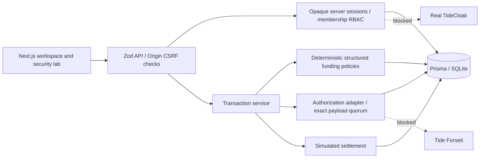

# Architecture

Money uses positive integer VND bounded at 1 billion per input. Funding eligibility is category AND beneficiary AND expiry AND available balance. Eligible contributions are sorted by ID and allocated proportionally to remaining capacity, with deterministic integer rounding. The last eligible contribution absorbs the remainder. No LLM participates in a policy decision.

Proposal creation, all reservations, state updates and audit events commit atomically. Conditional balance updates prevent overspending; failed mutations roll back. SQLite interactive transactions retry contention up to three times. Failed security requests are separately audited without session IDs or credentials.

The canonical JSON payload covers ID, requester, beneficiary, amount, category, destination, description, evidence, nonce, expiry and sorted allocation. Every organizational approval binds SHA-256 of that exact payload. The mock threshold is unanimous approval by the contributing organizations. Multiple members of one organization cannot substitute for another organization. Melbourne's independent verifier cannot be the requester.

An approved amendment clears prior approvals and authorization, releases reservations, rotates the nonce and returns to DRAFT. Re-proposal creates a new transaction with fresh allocation and approvals. Original audit history remains. Direct database tampering that changes payload fields without their hash is rejected on approval/settlement. A fully compromised database can rewrite hashes too and is outside this model.

State transitions: DRAFT → PROPOSED → PENDING_APPROVAL → AUTHORIZED → SETTLED. Pending requests can be REJECTED; pending/authorized requests can EXPIRE or return to DRAFT on amendment. FAILED is a supported terminal transition for future provider failures; transient database errors roll back without discarding a valid reservation. Expiration is swept on snapshot reads and authenticated mutations, not by a background scheduler.

The gateway verifies current policy, quorum, exact hash, provider identity, authorization expiry and reserves inside the same transaction as the debit and unique settlement/nonce insert. It never contacts a financial network. Organization balances are conservation ledgers: amount = available + reserved + spent.

Users see their own transactions; organization reviewers see transactions funded by their organizations. Synthetic organization names, policy commitments, memberships and aggregate balances are shared directory information. Beneficiary evidence and transaction details remain subject to ownership/reviewer checks.

Frontend views live in one responsive Next.js workspace with state navigation. Native form elements, labelled controls, keyboard focus, status messages, mobile layouts and reduced-motion support provide the accessible component layer. There are no external font/CDN dependencies.
